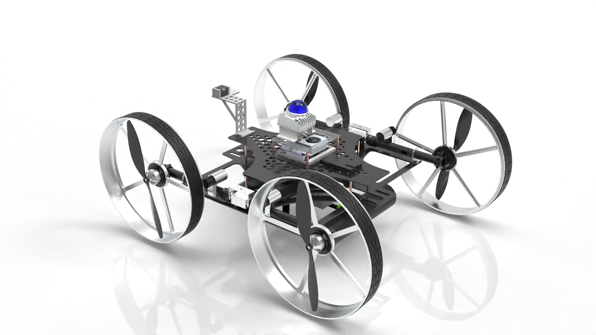
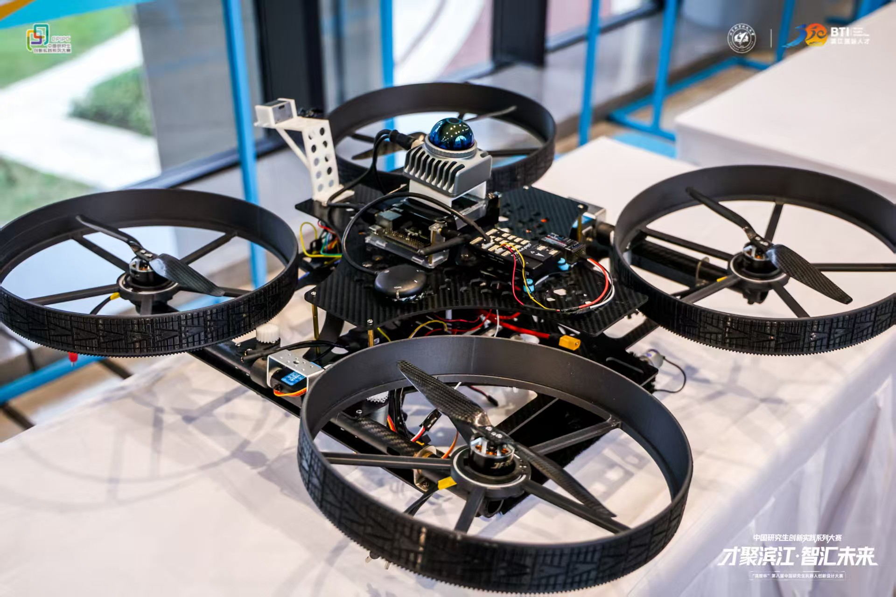

# 清蜓 · 陆空两栖光伏清洁巡检机器人

[](LICENSE) [](https://docs.ros.org/en/humble/) [](px4/Readme.md)

清蜓面向复杂光伏电站，将地面行走、空中跨越、滚筒清洁和红外巡检集成到同一平台。机器人通过舵机驱动机构切换陆空构型，在地面进行清洁和巡检，借助飞行跨越地面难以通过的障碍。

<p align="center">
  
  
</p>
机器人效果视频：https://github.com/user-attachments/assets/b95def22-a981-422c-b06c-d204810841ea

当前仓库提供 **ESP32-S3 底盘固件、ROS 2 地面导航、FAST-LIO2 三维点云建图、红外与可见光双路巡检、SolidWorks 模型和 PX4 版本说明**。底盘支持遥控、坡度补偿、弓字形清扫和 UART 通信。巡检程序可录制双路视频，并在温度达到阈值时保存告警照片。

## 目录

| 路径 | 内容 |
| --- | --- |
| [`底盘控制代码/`](底盘控制代码/) | PlatformIO 固件、引脚配置、串口协议和控制架构 |
| [`上位机代码/Lidar_nav2_ws/`](上位机代码/Lidar_nav2_ws/) | ROS 2 工作空间，含 Livox 驱动、LIO、点云重定位、Nav2 配置、示例地图和 Gazebo Classic 仿真 |
| [`FAST_LIO2_source/`](FAST_LIO2_source/) | 独立 ROS 2 `fast_lio` 包，含 MID-360 实机配置、RViz 配置和 PCD 地图保存功能 |
| [`thermal-monitoring/`](thermal-monitoring/) | C 语言红外 UVC 采集程序和 Python 双光监控、录制与告警脚本 |
| [`模型/`](模型/) | SolidWorks 总装、清洁滚筒、机臂、舵机支架及其他零件模型 |
| [`px4/`](px4/) | PX4 固件版本记录，实际固件按飞控型号从上游获取 |

## 硬件与接线

### 主要硬件

| 模块 | 硬件 | 用途 |
| --- | --- | --- |
| 机载计算 | NVIDIA Jetson 系列上位机。底盘文档和串口注释以 Orin Nano 为接线参考 | 运行 ROS 2、雷达驱动、建图、导航和双光巡检 |
| 地面控制 | ESP32-S3，PlatformIO 板卡目标为 `esp32-s3-devkitm-1` | 50 Hz 控制循环、编码器采样、坡度前馈、遥控和急停 |
| 底盘与清洁 | 4 路直流减速电机、TB6612 电机驱动、左右霍尔编码器、MPU6050、滚筒电机 | 四轮差速行走、姿态检测和光伏板清洁 |
| 激光雷达 | Livox MID-360 | 通过以太网向上位机提供点云和雷达内置 IMU 数据 |
| 飞行与变构 | Pixhawk 系列飞控、PX4 v1.16.0、无刷电机、电调、螺旋桨、变构舵机、遥控器及接收机 | 飞行控制和构型切换 |
| 巡检载荷 | 海康 UVC 测温热像仪（256×192）、IMX462 可见光相机 | 光伏组件测温告警和双路影像记录 |

在 SolidWorks 中打开 [`陆空两栖光伏清洁巡检机器人.SLDASM`](模型/陆空两栖光伏清洁巡检机器人.SLDASM) 查看总装，保留同目录下的零件文件以解析装配引用。飞控板型、舵机和电调通道及配电线束按实际装机配置核对。

### 系统连线

| 链路 | 接线与配置 |
| --- | --- |
| MID-360 ↔ Jetson | 通过雷达转接线将以太网接到 Jetson 网口，雷达按手册供电。仓库示例为主机 `192.168.1.50`、雷达 `192.168.1.162`，按实机修改 [`MID360_config.json`](上位机代码/Lidar_nav2_ws/src/livox_ros_driver2/config/MID360_config.json)。[Livox MID-360 手册](https://www.livoxtech.com/mid-360/downloads) |
| 双光相机 ↔ Jetson | 热像仪通过 USB 接入，采集程序匹配设备 ID `2bdf:0102`。原型机的 IMX462 也通过 USB 接入，在 Orin Nano 上枚举为 `USB FHD Camera`（示例为 `/dev/video2`）。程序也支持通过 Jetson CSI 接入的可见光相机。[相机接入说明](thermal-monitoring/readme.txt) |
| Jetson ↔ ESP32-S3 | UART1，`921600`、8N1。Jetson TX → ESP32 GPIO44，Jetson RX ← ESP32 GPIO43，GND 共地。固件注释中的 Orin Nano 排针参考为 TX Pin 8、RX Pin 10，按实物板型核对。串口连接使用 TX、RX 和 GND，两端独立供电。 |
| ESP32-S3 ↔ Pixhawk | 预留 UART2 ↔ TELEM2，MAVLink 2，ESP32 配置 `57600`、8N1。ESP32 GPIO38（TX）→ 飞控 RX，ESP32 GPIO39（RX）← 飞控 TX，GND 共地。先处理下方的 GPIO39 冲突，再按飞控板型核对信号定义，仅连接 TX、RX 和 GND，并将飞控对应串口波特率设为 `57600`。[PX4 MAVLink 串口配置](https://docs.px4.io/v1.16/en/peripherals/mavlink_peripherals) |
| 接收机 → ESP32-S3 | PWM 输出 CH1/CH2/CH9/CH10 → GPIO14/13/12/11。CH1 转向，CH2 前后，CH9 选择陆空模式，CH10 控制滚筒并可在摇杆回中时触发清扫。接收机与 ESP32 共地，接线前核对信号电平。 |
| MPU6050 ↔ ESP32-S3 | I²C，SDA → GPIO3，SCL → GPIO39，地址 `0x68`。 |
| 霍尔编码器 → ESP32-S3 | 左侧 A/B → GPIO15/16，右侧 A/B → GPIO41/40，共地。 |
| 滚筒电机驱动 ↔ ESP32-S3 | 独立 TB6612 通道，PWM → GPIO9，STBY → GPIO10。固件按固定转向设计，IN1 接 3.3 V，IN2 接 GND。 |
| 飞控 → 电调 → 无刷电机 | 电调控制信号接飞控输出，电调动力输出接无刷电机。飞控输出、旋翼编号、旋向和供电按实际机架配置核对。变构舵机按实际接收机或飞控输出配置接线。 |

### 四轮 TB6612 信号映射

| 轮位 | PWM | IN1 | IN2 |
| --- | --- | --- | --- |
| 左前 | GPIO5 | GPIO7 | GPIO6 |
| 左后 | GPIO48 | GPIO21 | GPIO47 |
| 右后 | GPIO17 | GPIO8 | GPIO18 |
| 右前 | GPIO1 | GPIO42 | GPIO2 |

底盘驱动共用 GPIO4 作为 STBY。将各轮电机接到对应驱动通道输出，驱动逻辑侧与 ESP32 共地，电机电源接驱动板的电机供电端。供电电压按电机、驱动板、电调、舵机和雷达各自的额定规格核对。[固件引脚配置](底盘控制代码/src/config.h)

> **接线前处理 GPIO39 冲突。** 当前 `config.h` 将 GPIO39 同时分配给 MPU6050 的 SCL 和飞控串口 RX，且默认启用 `MAVLINK_ENABLED`。只调试底盘时可在 `config.h` 中关闭该宏并断开 TELEM2。两路都使用时，先按实际 ESP32 模组选出可用的备用 GPIO，将其中一路迁移并同步更新接线和配置。N16R8 模组的 GPIO33–37 按固件标注为保留引脚。台架测试时卸下螺旋桨、架空车轮，确认模式切换和急停后再进行整机联调。

## 编译与运行

### 1. 获取仓库

```bash
git clone https://github.com/jounshenwang/land-air-robot.git
cd land-air-robot
```

### 2. 编译和烧录底盘固件

在 Windows 或 Linux 安装 [PlatformIO](https://platformio.org/install)，用 VS Code 打开 `底盘控制代码/`，或从仓库根目录运行以下命令。PlatformIO 按 `platformio.ini` 安装 `espressif32`、Arduino 框架和 `pololu/VL53L1X@^1.0.0`。串口监视器为 `115200`。保留 `platformio.ini` 中的两项 USB CDC 配置，以免 USB 调试日志占用上位机 UART 的 GPIO43/44。

```bash
cd "底盘控制代码"
pio run
pio run --target upload
pio device monitor
```

烧录后观察上电自检、编码器方向和俯仰角。CH9 脉宽大于 `1700 µs` 为地面模式。地面模式下可用遥控测试行走，再在摇杆回中时用 CH10 测试弓字形清扫。上位机 UART 下行为 7 字节速度指令，目标单位为编码器计数每 20 ms。上行为 15 字节状态反馈。帧格式、模式字段和 200 ms 指令超时见[底盘固件说明](底盘控制代码/README.md)。

### 3. 搭建 ROS 2 环境

| 用途 | 运行环境与主要依赖 |
| --- | --- |
| 上位机工作空间 | Ubuntu 22.04、ROS 2 Humble、Python 3、GCC/G++、CMake、colcon、rosdep。工作空间中的 Livox 驱动提供 `amd64` 和 `arm64` 两套 SDK 库。 |
| 地面仿真 | Gazebo Classic 11、`gazebo_ros_pkgs`、RViz2。现有批量启动脚本通过 `gnome-terminal` 打开多个窗口，无桌面环境可按脚本逐条启动节点。 |
| 地面导航 | Nav2、SLAM Toolbox、`pointcloud_to_laserscan`、`tf2`、PCL、Eigen、OpenCV、GTSAM、TBB、OpenMP，默认重定位还需要 KISS-Matcher 与 ROBIN。 |
| 飞控调试 | PX4 v1.16.0 和 QGroundControl。按飞控硬件单独安装固件。 |

机载部署前先确认是 Jetson Nano 还是 Jetson Orin Nano。Orin Nano 可采用基于 Ubuntu 22.04 的 JetPack 6。原版 Nano 的 JetPack 4 基于 Ubuntu 18.04，需单独适配 ROS 2 环境，也可先在 Ubuntu 22.04 主机上完成联调。[JetPack 6](https://developer.nvidia.com/embedded/jetpack-sdk-60) · [Jetson Linux R32](https://developer.nvidia.com/embedded/linux-tegra-r3276)

先按 [ROS 2 Humble 官方说明](https://docs.ros.org/en/humble/Installation/Ubuntu-Install-Debs.html)安装 ROS 2。以下命令从仓库根目录执行。首次使用 rosdep 时先执行 `sudo rosdep init`。

```bash
cd "上位机代码/Lidar_nav2_ws"
source /opt/ros/humble/setup.bash
sudo apt update
sudo apt install -y build-essential cmake ninja-build pkg-config \
  python3-colcon-common-extensions python3-rosdep python3-tk \
  gnome-terminal libtbb-dev ros-humble-gazebo-ros-pkgs \
  ros-humble-navigation2 ros-humble-nav2-bringup ros-humble-slam-toolbox \
  ros-humble-pointcloud-to-laserscan ros-humble-tf2-tools
rosdep update
rosdep install --from-paths src --ignore-src --rosdistro humble -r -y
```

**KISS-Matcher 初始化。** 仓库记录了 KISS-Matcher 的固定提交 `d32ba845a38c5d048f9d40b8153b1078a5bd2d6c`，但 `.gitmodules` 位于 `Lidar_nav2_ws/` 内部，且使用开发者专用 SSH 主机别名。新克隆时需将有权访问的项目分支克隆到 `src/registration/KISS-Matcher/` 并检出该提交，或按[公开上游](https://github.com/MIT-SPARK/KISS-Matcher)安装兼容版本。公开上游与固定提交的 CMake 要求可能不同。已有项目版源码时，从工作空间根目录执行：

```bash
make -C src/registration/KISS-Matcher cppinstall
bash scripts/build.sh
source install/setup.bash
```

`cppinstall` 安装 KISS-Matcher 与 ROBIN C++ 库，`build.sh` 通过 colcon 构建工作空间。GTSAM、`-fPIC`、本地安装前缀、可选 RTAB-Map 及低内存编译见[环境搭建](上位机代码/Lidar_nav2_ws/环境搭建.md)。如果 rosdep 报 KISS-Matcher 等源码依赖缺失，先按上述方式补齐，再构建工作空间。

### 4. 地面仿真与实机入口

在工作空间根目录先执行 `source install/setup.bash`。下表每次选择一行，切换建图和导航前结束上一套节点，避免重复发布 TF 或速度指令。

| 用途 | 命令 | 启动前检查 |
| --- | --- | --- |
| 仿真建图 | `bash scripts/mapping_sim.sh` | 将脚本中的 `/home/px4/Lidar_nav2_ws` 换成当前工作空间路径。给 FAST-LIO 和 SLAM Toolbox 启动命令补上 `use_sim_time:=true`。单独建图时注释掉脚本末尾的 Nav2 启动段，让 `/map` 由 SLAM Toolbox 发布。 |
| 仿真导航 | `bash scripts/nav2_sim.sh` | 将 KISS 重定位 launch 中的 `prior_pcd_file` 改成当前机器可访问的点云地图。脚本会启动 Gazebo Classic、重定位、Nav2 和生命周期辅助脚本。 |
| 实机建图 | `bash scripts/mapping_real.sh` | 配置 MID-360 的主机和雷达 IP、FAST-LIO 输入格式、实机时钟及 SLAM Toolbox 参数文件路径。 |
| 实机导航 | `bash scripts/nav2_real.sh` | 先完成实机配置和地图匹配，再激活 Nav2 节点。要驱动实车，还需独立部署 ROS 2 ↔ ESP32 串口桥。 |

**建图。** 操作机器人走完建图区域。在另一个加载了工作空间的终端使用 `bash scripts/save_map.sh` 保存二维 `YAML/PGM`，默认写到 `src/me_nav2_bringup/map/test_map__2.*`。使用 `bash scripts/save_pcd.sh` 调用 FAST-LIO 的 `/map_save` 服务保存 PCD，输出位置由 FAST-LIO 的 `map_file_path` 参数指定，默认是启动目录下的 `test.pcd`。脚本的默认保存文件名可在运行前修改。

**导航。** 在 [`my_nav2_launch.py`](上位机代码/Lidar_nav2_ws/src/me_nav2_bringup/launch/my_nav2_launch.py) 中设置二维地图，在 [KISS 重定位 launch](上位机代码/Lidar_nav2_ws/src/registration/global_relocalization_kiss_matcher/launch/global_kiss_matcher_relocalization_launch.py) 中设置对应的 `prior_pcd_file`。两份地图应处在一致的坐标系中，优先使用同一次建图保存的文件。打开 RViz2 后，用 **2D Pose Estimate** 给出初始位姿，待重定位成功、Nav2 节点进入 `active` 后，再发送 **Nav2 Goal**。

**实机参数。** 当前 FAST-LIO 配置 `mid360.yaml` 的 `preprocess.lidar_type` 为 `5`（仿真通用处理），配合实机 `fast_lio_msg_MID360_launch.py` 发布的 MID-360 `PointCloud2` 时改为 `4`。将相关 launch 和 YAML 中的 `use_sim_time` 统一设为 `false`，重点检查 `lio_interface`、`sensor_scan_generation`、`me_nav2_bringup`、SLAM Toolbox 和重定位配置，并检查雷达外参。修改源码配置后重新加载工作空间，必要时重新构建。`my_nav2_launch.py` 将导航组件的 `autostart` 设为 `False`。实机脚本只启动节点，可在工作空间中运行 `python3 src/me_nav2_bringup/scripts/manual_lifecycle_manager.py` 激活导航组件，然后用 `ros2 lifecycle get /controller_server` 确认状态。

**底盘接入。** 串口桥需要订阅 `/cmd_vel`，根据实测轮距、轮径和编码器参数换算左右轮速，以固件协议发送 `mode=2` 的 UART 帧并解析反馈。地面模式和有效遥控输入仍由 ESP32 侧检查。没有串口桥时，实机脚本可以用于检查建图、定位和 Nav2 输出。可用以下命令核对数据链：

```bash
ros2 topic hz /livox/lidar
ros2 topic hz /livox/imu
ros2 topic hz /registered_scan
ros2 topic hz /scan
ros2 run tf2_ros tf2_echo map odom
ros2 run tf2_ros tf2_echo odom base_footprint
ros2 topic echo /cmd_vel
```

更多参数与故障排查见[导航工作空间 README](上位机代码/Lidar_nav2_ws/README.md)。

### 5. 独立运行 FAST-LIO2 三维建图

只需要 MID-360 里程计和三维 PCD 地图时，可单独构建 [`FAST_LIO2_source/`](FAST_LIO2_source/)。它与 `Lidar_nav2_ws` 内的 FAST-LIO 都声明为 `fast_lio`，请在独立构建目录中选用这一份。完整地面导航仍使用上一节的 `Lidar_nav2_ws`。

在 Ubuntu 22.04 / ROS 2 Humble 环境中，从仓库根目录运行以下命令。构建依赖包括 CMake、C++ 编译器、Python 开发库、PCL、Eigen 和 Livox ROS Driver 2。驱动源码和对应架构的 SDK 库位于导航工作空间中。首次使用 rosdep 时，安装后先执行 `sudo rosdep init` 和 `rosdep update`。

```bash
repo_root="$(pwd)"
fast_lio_src="$repo_root/FAST_LIO2_source"
livox_src="$repo_root/上位机代码/Lidar_nav2_ws/src/livox_ros_driver2"
source /opt/ros/humble/setup.bash
sudo apt install -y build-essential cmake python3-dev libeigen3-dev libpcl-dev \
  python3-colcon-common-extensions python3-rosdep ros-humble-rviz2
mkdir -p "$HOME/fast_lio2_ws"
cd "$HOME/fast_lio2_ws"
rosdep install --from-paths "$fast_lio_src" "$livox_src" --ignore-src --rosdistro humble -r -y
colcon build --base-paths "$fast_lio_src" "$livox_src" --symlink-install
```

配置 MID-360 与上位机网口 IP 后，在两个终端分别执行 `source "$HOME/fast_lio2_ws/install/setup.bash"`，再依次启动驱动和建图：

```bash
# 终端一：发布 /livox/lidar（PointCloud2）和 /livox/imu
ros2 launch livox_ros_driver2 fast_lio_msg_MID360_launch.py

# 终端二：使用独立版的实机参数并打开 RViz
ros2 launch fast_lio mapping.launch.py config_file:=mid360.yaml
```

独立版 [`mid360.yaml`](FAST_LIO2_source/config/mid360.yaml) 默认用 `lidar_type: 4` 订阅 MID-360 的 `PointCloud2`。建图时可在 RViz 查看 `/cloud_registered`、`/Laser_map` 和 `/path`，里程计通过 `/Odometry` 发布。点云积累后，在已加载工作空间的终端调用 `ros2 service call /map_save std_srvs/srv/Trigger "{}"`，输出路径由 `map_file_path` 指定（默认 `./test.pcd`，相对于建图进程的工作目录）。使用默认配置并正常结束建图后，累积扫描也会写入 `FAST_LIO2_source/PCD/scans.pcd`。[FAST-LIO2 使用说明](FAST_LIO2_source/README.md)

### 6. 双光热斑检测与录制

在 Jetson Orin Nano 的 Ubuntu / JetPack 环境中运行。`make` 将 C 采集程序编译为 `uvc_demo`，`img.py` 通过它读取热像仪的温度矩阵和图像，再用 OpenCV 采集 IMX462 画面。USB 可见光相机使用 V4L2，CSI 接入时需要支持 GStreamer 的 OpenCV 和 JetPack 相机插件。以下命令从仓库根目录执行：

```bash
cd thermal-monitoring
sudo apt update
sudo apt install -y build-essential cmake git libusb-1.0-0-dev libjpeg-dev \
  usbutils v4l-utils python3-opencv python3-numpy
git clone https://github.com/libuvc/libuvc.git libuvc
cmake -S libuvc -B libuvc/build
cmake --build libuvc/build -j
sudo cmake --install libuvc/build
sudo ldconfig
make
python3 img.py
```

`uvc_camera.c` 使用 libuvc 的内部头文件，按上述目录布局保留 `libuvc/` 源码和构建目录。启动时按提示完成 `sudo` 验证，供 `uvc_demo` 访问热像仪。SciPy 为可选依赖，安装后使用中值滤波，缺省时使用 OpenCV 均值滤波。

| 用途 | 命令或输出 |
| --- | --- |
| 手动选择可见光相机 | `python3 img.py --v4l2-device /dev/video2`。设备编号可用 `v4l2-ctl --list-devices` 确认。 |
| CSI 参数 | USB/V4L2 探测失败时尝试 CSI，可用 `python3 img.py --sensor-id 0 --csi-width 1280 --csi-height 720 --csi-fps 60` 指定参数。 |
| 无显示器运行 | `python3 img.py --no-display`，按 `Ctrl+C` 结束录制。 |
| 双路视频 | 默认保存到 `recordings/`，文件名为 `thermal_*.mp4` 和 `csi_*.mp4`。 |
| 温度告警 | 滤波后的最高温度达到 `40 °C` 时，默认在 `captured_images/` 保存红外图和当时可用的可见光图。可用 `--alarm-threshold` 调整阈值。 |

巡检和建图分别启动。告警照片按系统时间命名，可见光照片使用触发时读取的画面。[相机运行说明](thermal-monitoring/readme.txt) · [热斑检测设计流程](底盘控制代码/docs/光伏热斑检测系统流程图.md)

### 7. PX4 飞控

在 QGroundControl 中按实际 Pixhawk 板型安装或加载 PX4 v1.16.0，校准传感器及遥控器，核对输出映射。ESP32 固件的 MAVLink 模块支持心跳和解锁／锁定联动。飞行仿真可单独在 PX4 源码目录中，按 [PX4 v1.16 开发环境](https://docs.px4.io/v1.16/en/dev_setup/dev_env_linux_ubuntu)完成工具链安装后运行 `make px4_sitl gz_x500`。该命令使用 PX4 的 X500 示例及新版 Gazebo，地面工作空间的 `mapping_sim.sh` 和 `nav2_sim.sh` 使用 Gazebo Classic。[PX4 v1.16.0 发布页](https://github.com/PX4/PX4-Autopilot/releases/tag/v1.16.0)

## 开源项目与依赖

| 项目或库 | 本仓库中的用途 |
| --- | --- |
| [Ikunio/Lidar_nav2_ws](https://github.com/Ikunio/Lidar_nav2_ws) | 地面建图和导航工作空间基础 |
| [ROS 2](https://github.com/ros2/ros2)、[Nav2](https://github.com/ros-navigation/navigation2)、[SLAM Toolbox](https://github.com/SteveMacenski/slam_toolbox)、[pointcloud_to_laserscan](https://github.com/ros-perception/pointcloud_to_laserscan) | 节点通信、二维地图、导航与点云转二维激光扫描 |
| [Livox ROS Driver 2](https://github.com/Livox-SDK/livox_ros_driver2)、[Livox SDK2](https://github.com/Livox-SDK/Livox-SDK2) | MID-360 点云和 IMU 接入 |
| [FAST-LIO](https://github.com/hku-mars/FAST_LIO)、[FAST-LIO ROS 2 移植](https://github.com/Ericsii/FAST_LIO_ROS2)、[Point-LIO](https://github.com/hku-mars/Point-LIO) | 激光惯性里程计与三维点云建图。导航脚本默认使用 FAST-LIO，Point-LIO 为备选 |
| [libuvc](https://github.com/libuvc/libuvc)、[libusb](https://libusb.info/)、[NumPy](https://numpy.org/)、[SciPy](https://scipy.org/)、[GStreamer](https://gstreamer.freedesktop.org/) | 红外 UVC 采集、温度矩阵运算、可选中值滤波和 Jetson CSI 视频接入 |
| [KISS-Matcher](https://github.com/MIT-SPARK/KISS-Matcher)、[ROBIN](https://github.com/MIT-SPARK/ROBIN)、[small_gicp](https://github.com/koide3/small_gicp) | 全局点云重定位、异常匹配剔除和局部配准 |
| [PCL](https://pointclouds.org/)、[Eigen](https://eigen.tuxfamily.org/)、[Sophus](https://github.com/strasdat/Sophus)、[GTSAM](https://github.com/borglab/gtsam)、[OpenCV](https://opencv.org/)、[oneTBB](https://github.com/uxlfoundation/oneTBB) | 点云处理、线性代数、李群运算、图优化、图像处理和并行计算 |
| [Gazebo Classic](https://classic.gazebosim.org/)、[gazebo_ros_pkgs](https://github.com/ros-simulation/gazebo_ros_pkgs) | 地面仿真与 ROS 2 接口 |
| [PX4 Autopilot](https://github.com/PX4/PX4-Autopilot)、[MAVLink](https://mavlink.io/)、[QGroundControl](https://qgroundcontrol.com/) | 飞控固件、遥测协议和地面站。ESP32 自行编解码所需 MAVLink 帧 |
| [PlatformIO](https://platformio.org/)、[Arduino-ESP32](https://github.com/espressif/arduino-esp32)、[Pololu VL53L1X](https://github.com/pololu/vl53l1x-arduino) | 底盘固件构建、Arduino 运行环境与 `platformio.ini` 声明的库 |

## 许可证

本项目自行编写的代码、文档及原创模型按 [MIT License](LICENSE) 发布。第三方源码、二进制、模型和资源沿用各自上游许可及版权声明。两份 FAST-LIO 源码目录都附有 GPL 许可文件，分别见[独立建图包](FAST_LIO2_source/LICENSE)和[导航工作空间版本](上位机代码/Lidar_nav2_ws/src/localization/FAST_LIO/LICENSE)。其他声明见[导航工作空间](上位机代码/Lidar_nav2_ws/LICENSE)、[Livox 驱动](上位机代码/Lidar_nav2_ws/src/livox_ros_driver2/LICENSE.txt)和[原模型](模型/LICENSE)。再分发第三方内容时请保留对应的许可与版权声明。
